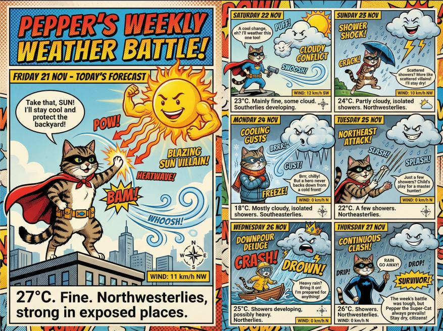
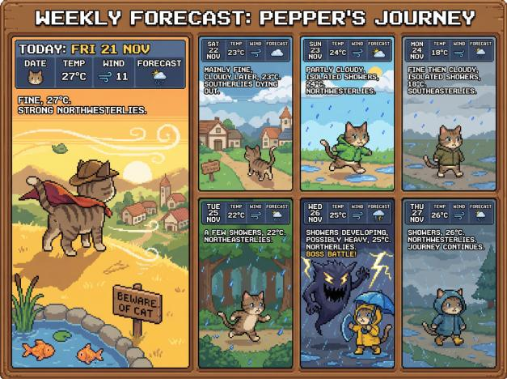
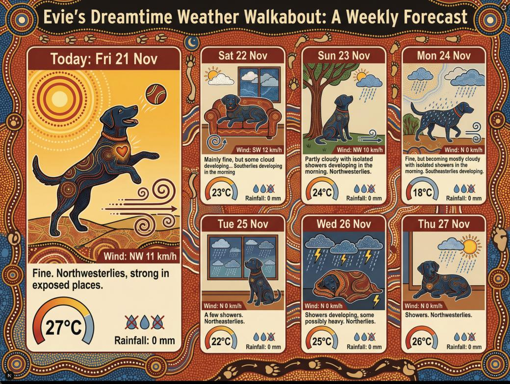

# Slothcast

AI-powered weather infographic generator that creates personalized weather visualizations featuring your family members and pets in randomized art styles.



## What It Does

Slothcast fetches your local weather data and generates unique artistic images that:

- Display current weather conditions in creative visual styles
- Feature customizable characters (family members, pets)
- Use 40+ randomized art styles (noir detective, watercolor, pixel art, and more)
- Cache generated images daily to avoid redundant API calls



## Getting Started

### Prerequisites

- Node.js 18+
- npm, yarn, pnpm, or bun
- [Replicate API token](https://replicate.com/account/api-tokens)
- (Optional) MetService API key for live weather data

### Installation

1. Clone the repository:

```bash
git clone <repository-url>
cd dilly-daily
```

2. Install dependencies:

```bash
npm install
```

3. Create a `.env.local` file with your API keys:

```bash
REPLICATE_API_TOKEN=your_replicate_token_here
METSERVICE_API_KEY=your_metservice_key_here  # Optional - falls back to mock data
```

4. Start the development server:

```bash
npm run dev
```

5. Open [http://localhost:3000](http://localhost:3000) in your browser.



## Customizing Characters

To personalize Slothcast with your own family members and pets, edit the `CHARACTERS` array in `app/lib/prompt.ts`:

```typescript
const CHARACTERS = [
  "Lachlan, a 12-year-old boy who loves sports...",
  "William, a 10-year-old boy who enjoys soccer...",
  "Thomas, a 7-year-old boy, creative and energetic...",
  "Pepper, a mischievous tabby cat...",
  "Evie, a gentle black Labrador...",
];
```

Replace these with descriptions of your own characters. Each description should include:

- Name and basic details (age for humans, breed for pets)
- Personality traits
- Hobbies or distinctive behaviors

The AI will use these descriptions to feature your characters in the generated weather scenes.

## Commands

| Command         | Description              |
| --------------- | ------------------------ |
| `npm run dev`   | Start development server |
| `npm run build` | Production build         |
| `npm run start` | Start production server  |
| `npm run lint`  | Run ESLint               |

## Tech Stack

- **Framework:** Next.js 16 with App Router
- **React:** 19.x
- **Styling:** Tailwind CSS v4
- **AI Image Generation:** Replicate API
- **Weather Data:** MetService API (with mock fallback)
- **Language:** TypeScript
